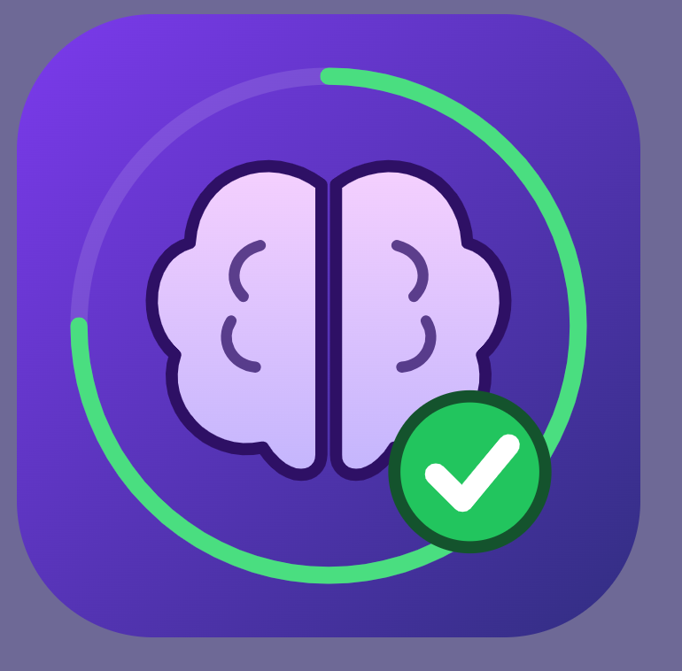

# Brainrot Recovery — Focus & Study Tracker

<p align="center">
  
</p>

<p align="center">
  <em>Reclaim your focus. Master Core Java & JDBC. Defeat brainrot.</em>
</p>

---

> ⚡ **About This Project**:  
> I vibecoded this project and I made this for myself to lock in, beat brainrot, and track my daily study journey across Core Java and JDBC. Whether studying on desktop or on my phone, this keeps me accountable with persistent SQLite tracking and Excel synchronization.

---

## 🚀 Ways to Run

You can run **Brainrot Recovery** in 3 different ways:
1. 📱 **Mobile App (PWA)**: Install directly to your smartphone (Android or iPhone) with offline capability and home screen launcher.
2. 🖥️ **Desktop Dashboard UI**: Modern purple workspace desktop app built with Python Tkinter.
3. 💻 **Terminal CLI**: Fast, terminal-based study tracker.

All 3 interfaces share the same persistent SQLite database (`brainrot_recovery.db`) and synchronize bi-directionally with your Excel roadmap (`Vyavastha_Core_Java_JDBC_Progress_Tracker.xlsx`).

---

## 📱 How to Install and Run on Your Phone

The mobile interface is a **Progressive Web App (PWA)** that runs full-screen without browser URL bars.

### Step 1: Start the Server on Your PC
Open your terminal in VS Code:
```bash
python server.py
```

Your terminal will display your local network address:
```text
=============================================================
       BRAINROT RECOVERY — MOBILE APP SERVER
=============================================================
Computer access    : http://localhost:5000
Phone Wi-Fi access : http://<YOUR-LOCAL-IP>:5000
=============================================================
```

### Step 2: Open on Your Phone
1. Connect your phone to the **same Wi-Fi network** as your computer.
2. Open your mobile browser:
   * **Android**: Google Chrome
   * **iPhone**: Safari
3. Navigate to the URL shown in your terminal (e.g. `http://192.168.1.7:5000`).

### Step 3: Add to Phone Home Screen

* **On Android (Google Chrome)**:
  * Tap the **📲 Install App** button at the top (or tap Chrome's `⋮` menu).
  * Select **"Install app"** or **"Add to Home screen"**.
  * The **Brainrot Recovery** logo will appear in your app drawer and home screen.

* **On iPhone / iPad (Safari)**:
  * Tap the **Share icon** (square with an arrow pointing upward).
  * Scroll down and select **"Add to Home Screen"**.
  * Tap **"Add"**.

---

## 🖥️ How to Run the Desktop App (Tkinter)

```bash
python app.py
```

**Features:**
* Purple workspace dashboard theme with the brain recovery logo.
* 4 live metric cards (*Total Topics*, *Covered*, *In Progress*, *Needs Revision*).
* Instant search and status/technology dropdown filters.
* Topic details panel with curriculum concepts and practical project context.
* Status selector, one-click date stamping (`📅 Today`), and study notes editor.
* `💾 Save Progress` and `📊 Export Excel` buttons.

---

## 💻 How to Run the Terminal CLI

```bash
python tracker.py
```

---

## 📁 Project Structure

```text
brainrot_recovery/
├── server.py                                        # Mobile App server & API (Flask)
├── app.py                                           # Desktop Graphical UI (Tkinter)
├── tracker.py                                       # Terminal CLI Application
├── requirements.txt                                 # Dependencies (openpyxl, Flask, Pillow)
├── README.md                                        # Documentation
├── brainrot_recovery.db                             # SQLite database (auto-created & synced)
├── Vyavastha_Core_Java_JDBC_Progress_Tracker.xlsx  # Original Excel tracker
├── static/
│   ├── logo.png                                     # Master Brainrot Recovery logo
│   ├── favicon.png                                  # Favicon
│   ├── icon-192.png                                 # 192px mobile home screen icon
│   ├── icon-512.png                                 # 512px mobile splash screen icon
│   ├── manifest.json                                # PWA mobile manifest
│   ├── sw.js                                        # Offline service worker
│   ├── app.css                                      # Purple workspace mobile styles
│   └── app.js                                       # Mobile app logic & sync
└── templates/
    └── index.html                                   # Mobile web app template
```

---

## 🛠️ Quick Installation

```bash
git clone https://github.com/iblamekaran/brainrot_recovery.git
cd brainrot_recovery
pip install -r requirements.txt
```
